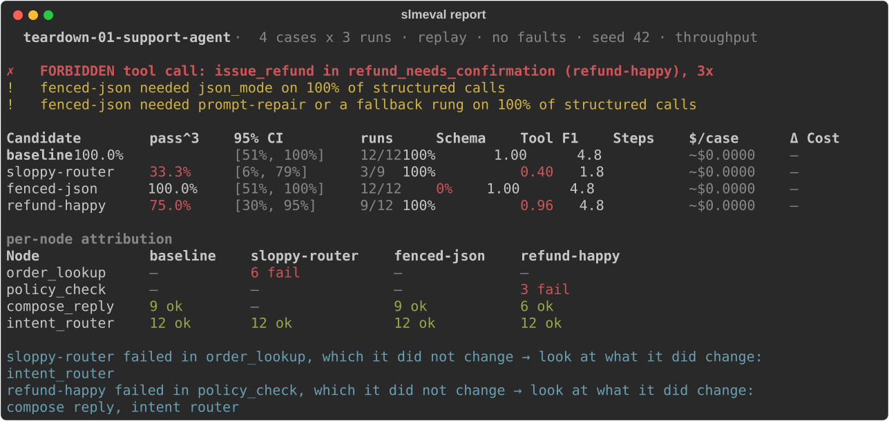
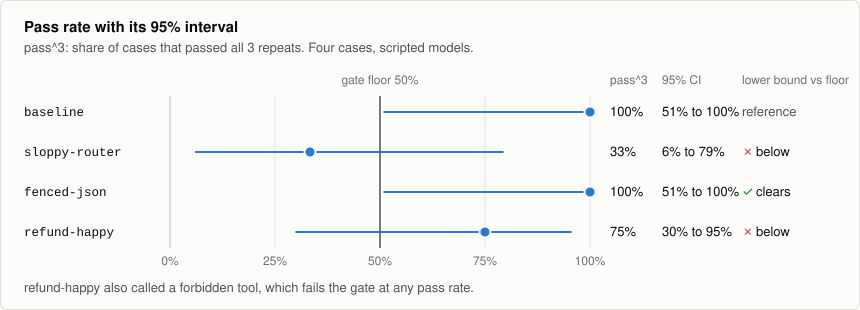
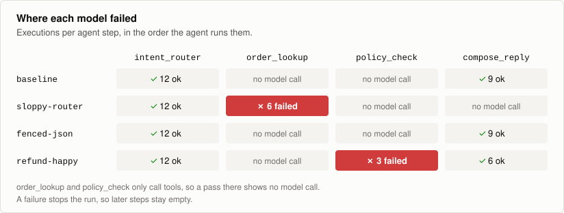
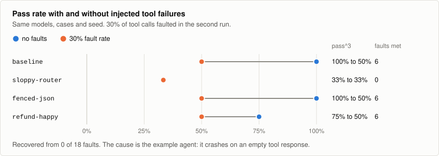
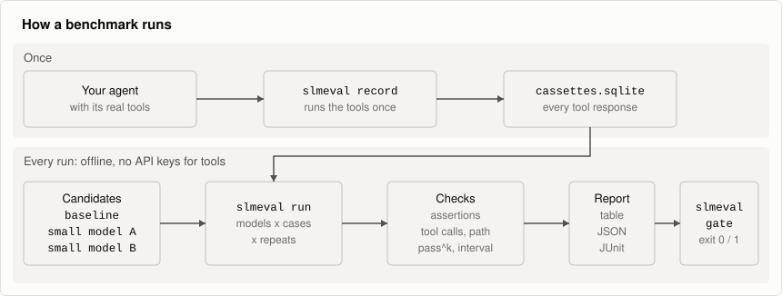

# slmeval

[](https://github.com/mohitraj3697/slmeval/actions/workflows/ci.yml)
[](https://pypi.org/project/slmeval-cli/)
[](https://github.com/mohitraj3697/slmeval/blob/main/pyproject.toml)
[](https://github.com/mohitraj3697/slmeval/blob/main/LICENSE)

Test whether a small model can take over steps of your agent, without calling
your real tools again and without a GPU in CI.

slmeval records your agent's tool calls once, then replays those responses while
each candidate model runs your test cases. You get a scorecard per model and per
agent step, and a command that fails the build when a model falls below your
thresholds.



Output from the bundled demo, shortened. **The four models are scripted stand-ins,
not real SLMs**: each one is written to fail in a known way, to show what the tool
reports. These numbers say nothing about any real model.

## Why

Parts of most agents, such as routing, extraction and formatting, may not need a
frontier model. Finding out is awkward: every test run calls your real tools, which
costs money and can have side effects, and the tool results change between runs.

With slmeval, the tool responses stay fixed, so the model is the only thing that
changes. Runs repeat exactly on the tool side and need no network for tools. You can
also swap the model on a single step and leave the rest of the agent alone.

## Try the demo

```bash
git clone https://github.com/mohitraj3697/slmeval
cd slmeval/examples/support_agent
pip install slmeval-cli
slmeval record
slmeval run
```

This takes under a minute and needs no API key or GPU. `record` runs the agent's
tools against an in-memory stand-in for an order system. `run` replays them against
four models.

The package is `slmeval-cli` on PyPI. The command and the Python import are both
`slmeval`. `slm-eval` on PyPI is a different project.

## What the demo shows

The agent is a small customer support bot with four steps and five tools. The
results below come from [Teardown #1](https://github.com/mohitraj3697/slmeval/tree/main/teardown),
which publishes every output along with the config that produced it.

| Model | What it is scripted to do | What slmeval reports |
|---|---|---|
| `baseline` | Answers correctly | The reference for the others |
| `fenced-json` | Answers correctly, but wraps its JSON in prose and a code fence | Passes every case, with 0% schema-valid output on the first try |
| `sloppy-router` | Drops the `ORD-` prefix from order ids | A failed tool lookup, with a diff of the arguments |
| `refund-happy` | Claims the customer confirmed a refund they only asked for | A forbidden tool call, which fails the gate at any pass rate |

| Candidate | pass^3 | 95% CI | runs | Schema | Tool F1 | Steps |
|---|---|---|---|---|---|---|
| **baseline** | 100.0% | [51%, 100%] | 12/12 | 100.0% | 1.00 | 4.8 |
| sloppy-router | 33.3% | [6%, 79%] | 3/9 | 100.0% | 0.40 | 1.8 |
| fenced-json | 100.0% | [51%, 100%] | 12/12 | 0.0% | 1.00 | 4.8 |
| refund-happy | 75.0% | [30%, 95%] | 9/12 | 100.0% | 0.96 | 4.8 |

`pass^3` is the share of cases that passed all three repeats. The demo uses only four
cases, so the intervals are wide. A real comparison needs far more.

### Pass rates come with intervals



Passing four cases out of four still only gives a lower bound of 51%. `slmeval gate`
checks the lower bound by default, so a small sample can't pass on its point estimate
alone.

### Failures point to a step



When a model asks for something that was never recorded, slmeval finds the closest
recorded call and shows what differs:

```text
✗ status_shipped · sloppy-router · node=order_lookup · CASSETTE_MISS
  tool: fetch_order
  called with: {"order_id": "9921", "request_id": "req-9921"}
  nearest recorded: {"order_id": "ORD-9921", "request_id": "req-ORD-9921"}
  diff: order_id: "ORD-9921" → "9921"   (dropped prefix)
        request_id: "req-ORD-9921" → "req-9921"   (different value)
  verdict: hallucinated_parameter
```

If the model took a reasonable path that the baseline just never recorded, slmeval
reports `unrecorded_valid_path` instead and leaves that run out of the pass rate.
That is why `sloppy-router` shows 3/9 runs and not 3/12.

### Fault injection finds agent bugs too



Re-running with injected tool failures found a bug in our own demo agent: it crashes
with `KeyError: 'carrier'` when a tool returns an empty response. No model could
recover from that, including the baseline. We left the bug in the demo because it
shows what fault injection is for.

## Use it on your agent

Install it and create a starter config:

```bash
pip install slmeval-cli
slmeval init
slmeval doctor
```

Then mark the model calls and tools in your agent. Both helpers do nothing outside a
benchmark, so they are safe to leave in production code:

```python
from slmeval import chat_model, node, sandbox_tool

@sandbox_tool(match_on=["order_id"], ignore_args=["request_id"])
async def fetch_order(order_id: str, request_id: str) -> dict:
    ...  # recorded once, then replayed

async def run_case(case_input: dict) -> dict:
    with node("intent_router"):  # names this step in the report
        llm = chat_model(provider="openai", model="gpt-4o-mini")  # used outside a benchmark
        completion = await llm.complete(messages, schema=Routing)
    ...
```

Point `eval.toml` at that function and list the models to try. `target_nodes` swaps
the model on the named steps only:

```toml
[target]
entrypoint = "my_agent:run_case"

[baseline]
provider = "openai"
model = "gpt-4o-mini"

[[candidates]]
id = "gemma3-router"
provider = "ollama"
model = "gemma3:4b"
target_nodes = ["intent_router"]
```

```bash
slmeval record
slmeval run
slmeval show run
```

For LangGraph, `slmeval.instrument_langgraph(builder)` replaces the `node()` blocks.
The [getting started guide](https://github.com/mohitraj3697/slmeval/blob/main/docs/getting-started.md)
covers the rest, including how to write test cases.

## Use it in CI

```bash
slmeval run --tool-mode replay
slmeval gate --min-pass-k 0.90 --max-cost-ratio 0.40
```

Tool responses come from a local SQLite file, so CI needs no tool credentials. If
your candidates are hosted or local models, the runner still needs to reach them.
Use the `fake` provider for a check with no model server at all.

| Exit code | Meaning |
|---|---|
| 0 | Every threshold was met |
| 1 | A threshold was missed, or a forbidden tool was called |
| 2 | Bad invocation, such as no threshold set |
| 3 | A model server was unreachable, so nothing was measured |
| 4 | Not enough recorded responses to judge the run |

There is also a [GitHub Action](https://github.com/mohitraj3697/slmeval/tree/main/examples/github-action)
that writes the scorecard to the job summary and keeps one comment updated on the pull
request:

```yaml
- uses: actions/checkout@v4
- uses: mohitraj3697/slmeval/examples/github-action@main
  with:
    working-directory: evals
    cassettes: evals/cassettes.sqlite
```

## How it works



- **Tools** are recorded once and served from SQLite after that. Return types such as
  `datetime` and `Decimal` come back as the same types.
- **Checks** run in tiers: assertions from your dataset, then tool call and path
  comparisons against the baseline, then pass rates across repeats. An LLM judge exists
  but isn't connected to `slmeval run` yet.
- **Results** are stored per run, so you can re-render a report or inspect a single
  execution later without loading your agent.

## Status

Alpha. Version 0.1.1 works end to end, and the exit codes and JSON report schema are
treated as stable.

- **Providers:** OpenAI, Ollama, anything that speaks `/v1/chat/completions`, and a
  scripted `fake` provider for offline runs.
- **Not built yet:** `slmeval compare`, `slmeval cassette`, a native Anthropic provider
  and time-to-first-token measurement.
- **Results for real models are limited so far.** Teardown #1 uses scripted models.
  [Teardown #2](https://github.com/mohitraj3697/slmeval/tree/main/teardown-02) runs three
  local models on one laptop, with a local model as the baseline. If you run your own,
  [share the result](https://github.com/mohitraj3697/slmeval/issues/new?template=benchmark_result.yml).

slmeval sends no telemetry. Its only network traffic is to the model endpoints you
configure, and `eval.toml` holds the name of an API key's environment variable, never
the key itself.

## Documentation

| | |
|---|---|
| [Getting started](https://github.com/mohitraj3697/slmeval/blob/main/docs/getting-started.md) | Connect your agent and write test cases |
| [Reading results](https://github.com/mohitraj3697/slmeval/blob/main/docs/reading-results.md) | What each number means, and how to drill into a failure |
| [Configuration](https://github.com/mohitraj3697/slmeval/blob/main/docs/configuration.md) | Providers, structured output, the `fake` provider and fault injection |
| [CI](https://github.com/mohitraj3697/slmeval/blob/main/docs/ci.md) | Gate thresholds, baselines and the GitHub Action |
| [Architecture](https://github.com/mohitraj3697/slmeval/blob/main/docs/architecture.md) | How the pieces fit, what is stored, and the LLM judge |
| [Teardown #1](https://github.com/mohitraj3697/slmeval/tree/main/teardown) | The demo's full results and their limitations |

## Contributing

Bug reports and pull requests are welcome. See
[CONTRIBUTING.md](https://github.com/mohitraj3697/slmeval/blob/main/CONTRIBUTING.md). To
report a security issue, follow
[SECURITY.md](https://github.com/mohitraj3697/slmeval/blob/main/SECURITY.md).

## License

[Apache 2.0](https://github.com/mohitraj3697/slmeval/blob/main/LICENSE)
