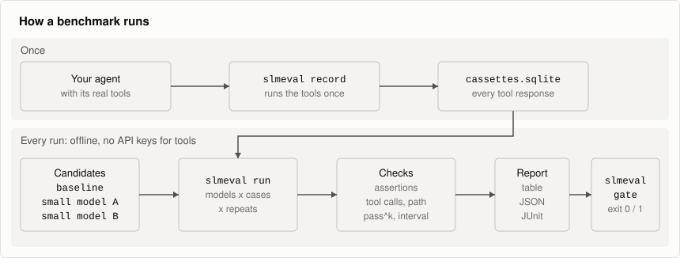

# Architecture



## Run flow

1. `slmeval record` runs the baseline once with real tools. Each tool response goes into
   the cassette store.
2. `slmeval run` builds the matrix of models × cases × repeats and runs it concurrently.
   Each execution gets its own context, so traces can't leak between candidates.
3. `chat_model()` looks up the current candidate and step, and routes the call. Providers
   return a common `Completion`, including which structured-output rung worked.
4. `@sandbox_tool` serves the call from the cassette store, applies any scheduled fault
   and records the outcome. A miss raises `CassetteMiss` with a diagnosis.
5. Evaluators score each execution. Scores and traces are written to the run store.
6. `report`, `show` and `gate` read only the run store and never import your agent.

## Source layout

| Package | Contents |
|---|---|
| `slmeval.core` | Runner, run context, model router, adapters' contract, outcome classification |
| `slmeval.adapters` | The LangGraph adapter |
| `slmeval.providers` | Provider clients, structured-output ladder, JSON extraction, `fake` |
| `slmeval.sandbox` | `@sandbox_tool`, cassette store and keys, typed envelope, faults, miss diagnosis |
| `slmeval.eval` | Evaluator tiers, statistics, cost, judge calibration |
| `slmeval.storage` | Run database, migrations, payload store, provenance |
| `slmeval.report` | Scorecard, per-step attribution, drill-down, exports |
| `slmeval.gate` | Gate checks and thresholds |
| `slmeval.cli` | The command line |

## Cassettes

A cassette key is built from the case, the tool and its arguments. Lookup tries an exact
match, then a normalized match, then a `match_on` subset, and records which tier hit.

Responses go through a typed envelope. `datetime`, `Decimal`, tuples, sets, enums, Pydantic
models and dataclasses come back as the same types. A value that can't be recorded
faithfully raises an error at record time, because flattening it to a string would make the
agent behave differently on replay.

When a tool's source changes, replay warns that the cassette may be stale. Re-record to
clear the warning.

## Evaluation tiers

| Tier | Checks | Cost |
|---|---|---|
| 1 | Dataset assertions, schema validity, tool names and arguments | None |
| 2 | Path distance, tool overlap with the baseline, loops, redundancy, fault recovery | None |
| 3 | An LLM judge against a rubric | Model calls. Not connected to `slmeval run` yet. |

An execution gets one outcome. A forbidden tool call takes priority over how the execution
ended, so an agent that issues a refund and then crashes is still reported as unsafe.

## Storage

Everything is under `.slmeval/` next to `eval.toml`.

| File | Contents |
|---|---|
| `cassettes.sqlite` | Recorded tool responses |
| `runs.sqlite` | Runs, executions, traces, metrics and rollups |
| Payload store | Large payloads addressed by SHA-256, so a response replayed by every candidate is stored once |

Each run records its config hash, dataset hash, git commit and host. `slmeval cache stats`
shows disk use and `slmeval cache prune` removes old runs.

## The LLM judge

Tier 3 is for what a rubric can express and an assertion can't, such as "does the reply
state the return window?". It stays off until you name a judge model, and it won't run
without a calibration record:

```bash
slmeval judge calibrate labels.jsonl
```

Calibration reports agreement with your own labels, its Wilson interval and Cohen's kappa,
and lists every disagreement. Kappa matters because a judge that always says "pass" scores
90% on a set where nine in ten pairs pass.

The judge doesn't grade runs that already failed, doesn't see which model wrote which
answer, and caches each judgement. The harness and calibration are built and tested, but
the judge isn't connected to `slmeval run` yet. See
[`examples/judge`](../examples/judge/README.md).

## Privacy

- Traces, cassettes and reports stay in `.slmeval/`.
- The only network traffic is to the model endpoints you configure, plus real tool calls
  during `record`.
- There is no telemetry.
- Cassettes contain your tools' real responses. `.slmeval/` is ignored by the default
  `.gitignore` in this repository, but check your own before committing anything from it.

## Design choices

- **Fixed tool responses.** Comparing models on live tools mixes model differences with
  changes in the data.
- **Repeats and intervals.** Models vary between runs even at temperature 0.
- **Separate failure classes.** A bug in slmeval, a gap in recordings and a server outage
  are kept out of pass rates, so they can't look like regressions.
- **No latency under concurrency.** It would mostly measure the queue.
- **Modelled local cost.** Local inference has no invoice, so its cost comes from token
  counts and a `--gpu-hourly` figure you supply, and is labelled as modelled.
