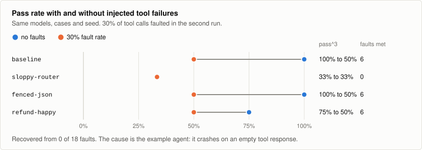

# Reading results

## The scorecard

| Column | Meaning |
|---|---|
| `pass^k` | Share of cases that passed all `k` repeats |
| `95% CI` | Wilson 95% interval on that share |
| `runs` | Passing executions out of those counted |
| `Schema` | Share of structured calls that were valid on the first try, with no repair or fallback |
| `Tool F1` | Overlap with the baseline's tool calls |
| `Steps` | Mean steps per execution |
| `p95 ms` | Latency. Shown only for runs made with `--serial-latency`. |
| `$/case` | Cost per case. `~` means token counts were estimated. |
| `Δ Cost` | Cost compared with the baseline |

Warnings print above the table. A forbidden tool call is always first.

### pass^k and the interval

`pass^k` counts a case only if every repeat passed. An agent generally gets one attempt
in production, so an average across repeats would flatter it.

The interval shows how much a small sample can tell you. Three passes out of three has
a point estimate of 100% and a lower bound of about 44%. Four cases out of four has a
lower bound of 51%. `slmeval gate` reads the lower bound unless you pass
`--use-point-estimate`.

### Schema and repairs

A model can pass every case and still have a low `Schema` score. In the demo,
`fenced-json` has a 100% pass rate and 0% `Schema`, because each of its answers had to
be extracted from prose and a code fence. Your production stack would need the same
repair path, so the two numbers mean different things.

### What isn't counted

These stay out of the pass rate and print above the table instead:

| Outcome | Meaning |
|---|---|
| `harness_error` | A bug in slmeval |
| `uncovered` | The model took a path with no recording, which is a coverage gap |
| `provider_error` | The model server didn't answer |

A crash in your agent is counted, because it is a real failure of the run.

## Cassette misses

When a replay finds no matching recording, slmeval looks up the nearest recorded call,
compares the arguments and gives a verdict:

| Verdict | Meaning | Counted against the model? |
|---|---|---|
| `hallucinated_parameter` | Right tool, corrupted argument | Yes |
| `hallucinated_tool` | The tool doesn't exist | Yes |
| `wrong_tool_for_step` | A real tool, in the wrong place | Yes |
| `unrecorded_valid_path` | A plausible call the baseline never made | No. Fix it by re-recording. |

## Drilling into a failure

```bash
slmeval show run
slmeval show run --failed
slmeval show exec sloppy-router.status_shipped.r0
slmeval show case status_shipped --candidate sloppy-router
slmeval show uncovered
```

`show run` lists executions, worst first. `show exec` gives one execution's timeline,
metrics and final state. `show case` puts a candidate next to the baseline, step by
step, with any cassette-miss diagnosis inline:

```text
  status_shipped  baseline → sloppy-router
  passed → cassette_miss · 6 → 2 steps

trajectory
#    baseline              sloppy-router
1    intent_router         intent_router
2    order_lookup          order_lookup
3    policy_check     -    —
4    compose_reply    -    —
```

Every `show` view accepts `--json`. None of them load your agent, so old results stay
readable after you change your code.

## Other formats

```bash
slmeval report --format md
slmeval report --format json
slmeval report --format csv
slmeval report --format junit --out results.xml
```

Markdown suits pull request comments. JUnit gives one test case per candidate per case,
for CI dashboards. The JSON report carries a `schema` version.

## Fault injection results

A run with faults adds a recovery rate: the share of executions that met a fault and
still passed. An execution that met no fault doesn't count, so a model that stops early
gets no recovery figure at all.

Each run records the faults it met. Two models on different paths can meet different
faults, so check for that before comparing them. `slmeval show case` reports it, and
`slmeval gate --require-fault-parity` enforces it.



If every model drops by the same amount, including the baseline, look at the agent
before the models.
